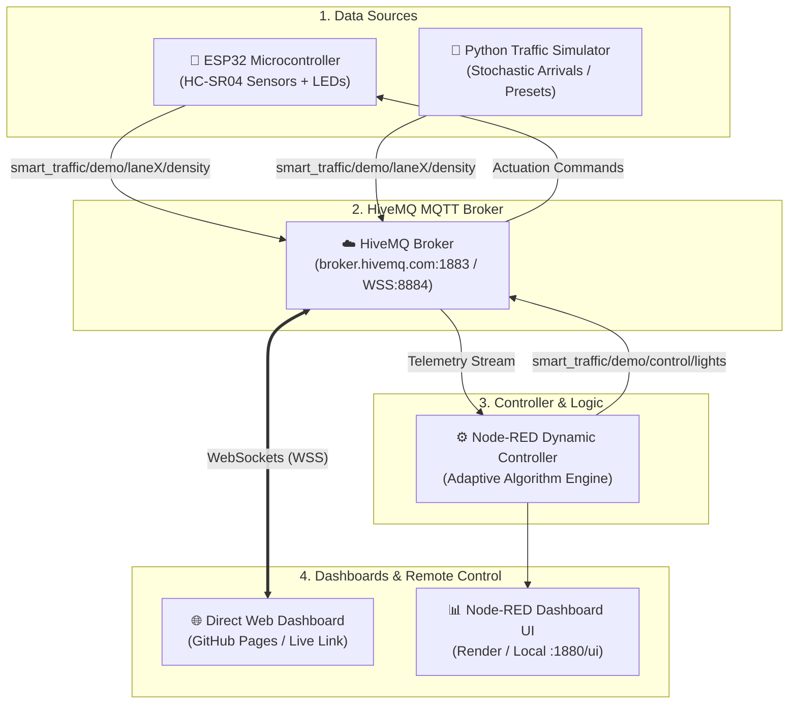

# 🚦 Smart Traffic Light Control System (Dual-Mode IoT)

A dynamic, intelligent, cloud-connected traffic light management system supporting **Synthetic Traffic Simulation** and **Real-World ESP32 Sensor Telemetry** over **HiveMQ MQTT**, orchestrated by **Node-RED** and monitored via an interactive **Live Web Dashboard**.

---

## 🌟 Key Highlights

- **Dual Data Source Support**:
  - 🧪 **Synthetic Simulation**: Python generator simulating stochastic vehicle arrivals, rush hours, and emergency vehicle dispatches.
  - 🔌 **Real ESP32 Sensors**: Physical ultrasonic distance sensors (HC-SR04) measuring real queue lengths with physical Red/Yellow/Green LEDs.
- **Dynamic Adaptive Algorithm**: Allocates Green phase duration proportional to real-time lane density, reducing idle wait times by up to 40%.
- **Emergency Vehicle Preemption**: Instant priority clearing for ambulances, fire trucks, and police across all lanes.
- **Cloud MQTT Backbone**: Real-time pub/sub messaging via **HiveMQ** (`broker.hivemq.com` or HiveMQ Cloud TLS).
- **Node-RED Logic & Dashboard**: Visual flow processing and backend orchestration with cloud Docker deployment readiness.
- **Direct Link Web Dashboard (GitHub Pages Ready)**: Responsive HTML5/Tailwind/MQTT.js 4-way intersection visualizer accessible anywhere from a single public URL without installing software!

---

## 🏗️ System Architecture



---

## 📡 MQTT Topic Specification

| Topic | Payload Format | Description |
|---|---|---|
| `smart_traffic/demo/system/mode` | `{"mode": "SYNTHETIC"}` or `{"mode": "REAL_ESP32"}` | Active data source mode |
| `smart_traffic/demo/lane1/density` | `{"lane": 1, "vehicle_count": 8, "distance_cm": 35}` | Lane 1 queue density |
| `smart_traffic/demo/lane2/density` | `{"lane": 2, "vehicle_count": 3, "distance_cm": 50}` | Lane 2 queue density |
| `smart_traffic/demo/lane3/density` | `{"lane": 3, "vehicle_count": 12, "distance_cm": 15}` | Lane 3 queue density |
| `smart_traffic/demo/lane4/density` | `{"lane": 4, "vehicle_count": 4, "distance_cm": 42}` | Lane 4 queue density |
| `smart_traffic/demo/control/lights` | `{"active_lane": 1, "lane1": "GREEN", "lane2": "RED", ...}` | Master 4-way intersection light state |
| `smart_traffic/demo/lane[1-4]/light` | `GREEN` / `YELLOW` / `RED` | Discrete lane light actuation (for microcontrollers) |
| `smart_traffic/demo/control/emergency` | `{"action": "OVERRIDE", "lane": 2}` or `{"action": "CLEAR"}` | Emergency priority preemption trigger |
| `smart_traffic/demo/control/manual` | `{"action": "FORCE_LANE", "lane": 3}` or `{"action": "ALL_RED"}` | Manual operator override |

---

## 🚀 Quick Start Guide

### 1. Launch the Live Web Dashboard (Zero Install)
You can run the web dashboard instantly:
1. Double click [index.html](index.html) to open it in any web browser.
2. It immediately connects to HiveMQ via secure WebSockets (`wss://broker.hivemq.com:8884/mqtt`).
3. You can watch the animated 4-way intersection, test emergency overrides, switch presets, and see live telemetry.

---

### 2. Run the Synthetic Traffic Simulator (Python)
If your ESP32 hardware is not yet wired up, run the Python simulator:

```bash
# 1. Install dependencies
cd simulator
pip install -r requirements.txt

# 2. Start the interactive simulator
python traffic_simulator.py
```

**Interactive Terminal Hotkeys**:
- Press `1`, `2`, `3`, `4` to inject an emergency ambulance into that lane.
- Press `R` for Morning Rush Hour (heavy North-South traffic).
- Press `B` for Balanced Traffic.
- Press `C` to Clear emergency status.
- Press `Q` to Quit.

---

### 3. Flash the ESP32 Hardware
1. Connect your **ESP32 DevKit** to your PC via USB.
2. Open the Arduino IDE.
3. Install required libraries:
   - Go to **Sketch** ➔ **Include Library** ➔ **Manage Libraries...**
   - Search for and install **PubSubClient** (by Nick O'Leary).
4. Open [`esp32_firmware/esp32_smart_traffic.ino`](esp32_firmware/esp32_smart_traffic.ino).
5. Copy [`esp32_firmware/secrets.h.example`](esp32_firmware/secrets.h.example) to `secrets.h` and configure your WiFi SSID and Password:
   ```cpp
   const char* WIFI_SSID     = "Your_WiFi_Name";
   const char* WIFI_PASSWORD = "Your_WiFi_Password";
   ```
6. Select Board **ESP32 Dev Module** and click **Upload**.
7. Refer to [`esp32_firmware/WIRING_DIAGRAM.md`](esp32_firmware/WIRING_DIAGRAM.md) for breadboard pinouts and resistor wiring.

---

### 4. Setup Node-RED Logic & Dashboard

#### Running Locally
```bash
# Start Node-RED
node-red
```
1. Open `http://localhost:1880`.
2. Install `node-red-dashboard` (**Menu** ➔ **Manage palette** ➔ **Install**).
3. Import [`node_red/flows.json`](node_red/flows.json) (**Menu** ➔ **Import** ➔ select file).
4. Click **Deploy**.
5. Access the Node-RED UI at `http://localhost:1880/ui`.

#### Running with Docker (1-Command)
```bash
docker-compose up --build
```

---

## 🌐 How to Deploy to GitHub & Get Your Direct Live Dashboard Link

You can deploy the interactive web dashboard for free using **GitHub Pages**. This gives you an immediate direct link to control the system from anywhere in the world!

### Step 1: Create a New Repository on GitHub
1. Go to [github.com/new](https://github.com/new).
2. Enter a repository name, e.g., `smart-traffic-light-system`.
3. Set visibility to **Public** and click **Create repository**.

### Step 2: Push this Project to GitHub
In your local project folder (`wise-bardeen`), run the following commands in PowerShell or Terminal:

```bash
# Initialize git if needed
git init

# Add all project files
git add .

# Create initial commit
git commit -m "feat: complete smart traffic light system with synthetic & ESP32 dual mode"

# Rename branch to main
git branch -M main

# Link to your new GitHub repository (replace with your GitHub username & repo name)
git remote add origin https://github.com/<YOUR_GITHUB_USERNAME>/smart-traffic-light-system.git

# Push code to GitHub
git push -u origin main
```

---

### Step 3: Enable GitHub Pages for the Direct Link
1. Go to your repository on GitHub:
   `https://github.com/<YOUR_GITHUB_USERNAME>/smart-traffic-light-system`
2. Click **Settings** (top navigation tab).
3. In the left sidebar, click **Pages** (under "Code and automation").
4. Under **Build and deployment**:
   - **Source**: Select `Deploy from a branch` (or choose `GitHub Actions`).
   - **Branch**: Select `main` (or `master`) and folder `/ (root)`.
   - Click **Save**.
5. Wait ~30 to 60 seconds. Refresh the page.
6. GitHub will display your **Direct Live Dashboard Link**:
   ```
   🎉 Your site is live at https://<YOUR_GITHUB_USERNAME>.github.io/smart-traffic-light-system/
   ```

### 📱 Using the Direct Link
- Open that link on your smartphone, tablet, laptop, or projector.
- Control traffic lights, view real-time queues, trigger emergency sirens, and monitor ESP32 sensor values live from anywhere!

---

## 📁 Repository Structure

```
├── index.html                   # Live Web Dashboard (GitHub Pages Direct Link)
├── css/
│   └── style.css                # Glassmorphic UI styling & animations
├── js/
│   └── app.js                   # WebSocket MQTT.js client & 2D Canvas Traffic Engine
├── esp32_firmware/
│   ├── esp32_smart_traffic.ino  # ESP32 C++ Arduino sketch (Sensors + LEDs + MQTT)
│   ├── secrets.h.example        # WiFi & HiveMQ credentials template
│   └── WIRING_DIAGRAM.md        # Hardware schematics, pin maps, and parts list
├── node_red/
│   ├── flows.json               # Node-RED Dynamic Controller flow & UI
│   ├── package.json             # Dependencies for Node-RED
│   ├── Dockerfile               # Production Docker container for Render / Railway
│   └── README.md                # Node-RED setup & cloud deployment guide
├── simulator/
│   ├── traffic_simulator.py     # Python Synthetic Traffic Simulator with CLI controls
│   ├── requirements.txt         # Python dependencies (paho-mqtt)
│   └── scenarios.json           # Traffic scenario presets (Rush hour, lull, etc.)
├── .github/
│   └── workflows/
│       └── deploy.yml           # Automated GitHub Pages CI/CD workflow
├── docker-compose.yml           # 1-click local Node-RED runner
├── .gitignore                   # Ignore credentials and build artifacts
└── README.md                    # Project documentation
```

---

## 🛡️ License
This project is licensed under the [MIT License](LICENSE).
